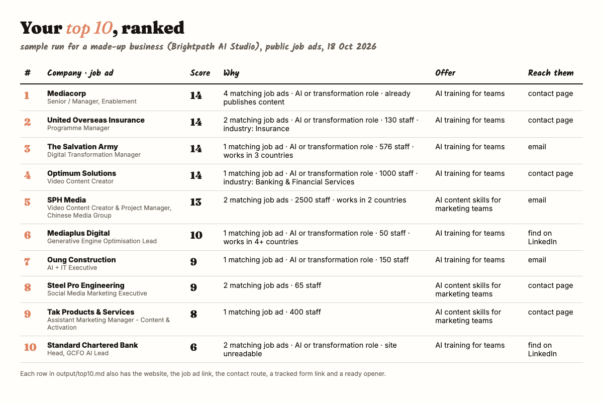

# Lead finder, built with Claude

Finds companies that are hiring right now for the kind of work you sell.
Reads each company's website with a free model that runs on your own computer.
Hands you a ranked top 10, each with the reason, a contact route, an opener and a tracked link to your enquiry form.

No API key. No monthly fee. Nothing is sent for you: you read the list and send each message yourself.



*The sample above uses a made-up business ("Brightpath AI Studio") on real public job ads from 18 Oct 2026.*

## How it works

1. **Signals.** A company hiring an "AI transformation manager" or a "content marketing executive" has a budget and a gap. In Singapore the lead finder reads the public [MyCareersFuture](https://www.mycareersfuture.gov.sg/) job board (free, no key). In any country you can list homepages in `extra_sites.txt`.
2. **Read.** [ScrapeGraphAI](https://github.com/ScrapeGraphAI/Scrapegraph-ai) opens each homepage in a hidden browser, and a local model in [Ollama](https://ollama.com) pulls out what the company does, its industry, where it works and any public contact route.
3. **Score.** Plain rules from your `config.yaml`: matching roles, company size, industry, more than one country, already posts content, a contact route found. Recruiters, agencies and competitors are dropped. The rules are fixed, so the ranking only moves when the job ads or the websites change.
4. **Write.** `output/top10.md` (read this) and `output/all_leads.csv` (every company, ranked). A dated copy goes in `output/history/`.

## Set it up with Claude (the easy route)

You need the Claude desktop app, a Mac or Windows PC with about 8 GB of free disk, and 15 to 30 minutes (most of it is downloads).

1. Open the Claude desktop app and click the **Code** tab.
2. Pick a folder to work in, for example your Documents folder.
3. Paste this prompt and press Enter:

```text
Set up the lead finder from https://github.com/EasyAIHenry/lead-finder-claude in a new
folder called lead-finder inside this folder. Read its CLAUDE.md and follow it. Make a
Python 3.12 environment with uv (or Homebrew Python, never the Mac's built-in python3),
install requirements.txt and Playwright's Chromium, and make sure Ollama is installed
and running with the qwen2.5:7b-instruct model. Then ask me four questions, one at a
time: my business, what I sell and to whom, my country, and my enquiry form or booking
link. Fill config.yaml from my answers and show it to me. Run a 3-company test and show
me the top 10. Ask me before you install anything outside the folder. Never send any
message or email for me.
```

Claude reads this repo, does the set-up, asks you the four questions and runs the first test. Approve each step when it asks.

## Set it up by hand (the backup route)

Mac or Linux, in Terminal:

```bash
git clone https://github.com/EasyAIHenry/lead-finder-claude.git lead-finder
cd lead-finder
./scripts/setup.sh                      # makes .venv on Python 3.12+, installs everything
ollama pull qwen2.5:7b-instruct         # 4.7 GB, once. Install Ollama from ollama.com first.
cp config.example.yaml config.yaml      # then edit config.yaml with your business
.venv/bin/python lead_finder.py --max 3 # quick test
.venv/bin/python lead_finder.py         # full run
```

Windows (PowerShell), with [uv](https://docs.astral.sh/uv/) installed:

```powershell
uv venv --python 3.12 .venv
uv pip install --python .venv -r requirements.txt
.venv\Scripts\python -m playwright install chromium
ollama pull qwen2.5:7b-instruct
copy config.example.yaml config.yaml
.venv\Scripts\python lead_finder.py --max 3
```

Use a smaller, faster, weaker model: `LEAD_MODEL=ollama/llama3.2 .venv/bin/python lead_finder.py` (pull it first with `ollama pull llama3.2`).

## What goes in config.yaml

| Setting | What it is |
|---|---|
| `business.name` | Your business name, shown at the top of the top 10 |
| `business.country` | `Singapore` turns on the job board. Anything else uses `extra_sites.txt` only |
| `business.enquiry_link` | Your form or booking page with `{src}` in it, for example `https://yoursite.com/contact?src={src}` |
| `business.proof` | One line that proves you can do it (optional) |
| `routes` | One block per thing you sell: the opener line, an optional `priority` for the first sentence, job-board searches, the job titles that count, bonus points |
| `in_house_titles_regex` | Job titles that mean the company is hiring the exact thing you sell. Flagged in the "why", -3 points |
| `skip_words` | Company names to drop (recruiters, competitors, current clients) |
| `competitor_words` | Words on a company's own site that mark it as a competitor (score -10) |
| `good_industries` | Industries that buy from you (+2 each) |
| `size` | Staff counts for +4, +2 and -2 |
| `max_companies` | How many websites to read per run |

Every company gets its own link, for example `https://yoursite.com/contact?src=acme`. Add a hidden field called `src` to your form (Tally, Typeform, Jotform, HubSpot forms and most WordPress form plugins can fill a hidden field from the link), and each enquiry tells you which lead it came from. Booking pages that only keep UTM tags, such as Calendly, need `utm_source={src}` instead.

## What to expect

- **Time.** About 5 to 60 seconds per website on a recent Mac with `qwen2.5:7b-instruct`, usually under 30. In our test, 12 new websites took about 2.5 minutes. Plan on 15 to 20 minutes for 40. Websites already read are cached, so the next run is faster (`--fresh` re-reads them).
- **Emails are rare.** Most company sites show a contact form or a contact page, not an email. The top 10 gives you the best route it found, in this order: public email, contact page, LinkedIn page. Often the best move is to find the hiring manager or the team lead on LinkedIn.
- **Some sites can't be read.** Big sites that block bots come back empty. They lose 3 points and are marked "check it by hand".
- **The model makes mistakes.** It can guess an industry wrong or miss an email that is on the page. Open the site before you send anything.
- **It finds companies, not people.** You still pick the right person and write the first line yourself.
- **Scores.** Up to about 22. Matching job ads count most (3 each, up to 3 ads). 10 or more is worth a look. Each job ad shows its posting date, so you can see how fresh the need is.
- **Matches can be loose.** A title like "Finance Operations & Transformation" matches the word "transformation". If a match looks wrong, tighten that route's `title_regex` or add the word to `ignore_titles_regex`.

## Fixes

| Problem | Fix |
|---|---|
| `pip` installs ScrapeGraphAI 1.20.1, or imports fail | You are on Python older than 3.12 (the Mac's built-in `python3` is 3.9). Run `./scripts/setup.sh`, which refuses old Python |
| `Executable doesn't exist` (Playwright) | `.venv/bin/python -m playwright install chromium` |
| `Connection refused` on port 11434 | Ollama is not running. Open the Ollama app, or run `ollama serve` |
| `model "qwen2.5:7b-instruct" not found` | `ollama pull qwen2.5:7b-instruct` |
| Every row is empty | The model is too small or the site blocks bots. Try `qwen2.5:7b-instruct`, and check the site opens in your browser |
| `The parsed content is empty` in the output | That site blocked the hidden browser or loads everything with scripts. The run carries on and marks it "check it by hand" |
| `No companies found` | Outside Singapore, add homepages to `extra_sites.txt`. In Singapore, widen `searches` or `title_regex` |
| A competitor or recruiter is in your top 10 | Add a word from its name to `skip_words` |
| Very slow, fans loud | Use `--max 10`, or `LEAD_MODEL=ollama/llama3.2` |

## Rules for sending

This repo finds companies. What you send, and how, is on you.

- **Send one by one.** Read the site, find the right person, change the first line, then send. Do not paste the whole list into a mail-merge.
- **Singapore, email.** The Spam Control Act covers commercial email sent in bulk (more than 100 similar messages in 24 hours, 1,000 in 30 days or 10,000 in a year). Bulk commercial email needs `<ADV>` with a space at the start of the subject, your real name and contact details, and a working unsubscribe. Honour unsubscribes within 10 business days.
- **Singapore, PDPA.** Business contact information (a person's name, job title, work email and work phone, given for business) is outside most of the PDPA's data protection rules. Personal emails and personal phone numbers are not. Check the Do Not Call registry before you call or text a Singapore number.
- **UK.** Emailing a company's general address is generally fine if you say who you are and give an opt-out. Sole traders and partnerships count as individuals and need consent first. Every cold email needs an unsubscribe line.
- **Everywhere.** Only use what the company publishes itself. Respect each site's terms. Stop when someone says no.

This is general information, not legal advice. Check the rules where you and your leads are.

## Track it with your team

Keep one shared sheet with the stages Not contacted, Messaged, Replied, Call booked, Won, Not now, and give every lead one owner. Follow up once after about 7 days, then mark it Not now. Paste this in the Code tab after each run:

```text
Make output/tracker-new.csv for Google Sheets with only the leads from output/all_leads.csv
that scored above 0 and are not listed in output/exported.txt. Columns: company, website,
why, job ad, contact email, contact page, LinkedIn, form link, opener, plus empty Person,
Stage (Not contacted), Owner, Last touch, Next step. Then add those company names to
output/exported.txt.
```

In Google Sheets, import `tracker-new.csv` with File, Import, Upload, **Append to current sheet**. Only new companies are in the file, so nothing your team typed in the sheet is touched.

## Run it every weekday

The lead finder runs on your computer, so your computer must be awake and Ollama must be running at that time.

**Mac, with launchd** (survives restarts). Save this as `~/Library/LaunchAgents/com.leadfinder.daily.plist`, change the two paths, then run `launchctl load ~/Library/LaunchAgents/com.leadfinder.daily.plist`:

```xml
<?xml version="1.0" encoding="UTF-8"?>
<!DOCTYPE plist PUBLIC "-//Apple//DTD PLIST 1.0//EN" "http://www.apple.com/DTDs/PropertyList-1.0.dtd">
<plist version="1.0"><dict>
  <key>Label</key><string>com.leadfinder.daily</string>
  <key>ProgramArguments</key><array>
    <string>/Users/YOU/Documents/lead-finder/.venv/bin/python</string>
    <string>/Users/YOU/Documents/lead-finder/lead_finder.py</string>
  </array>
  <key>StartCalendarInterval</key><array>
    <dict><key>Weekday</key><integer>1</integer><key>Hour</key><integer>8</integer><key>Minute</key><integer>0</integer></dict>
    <dict><key>Weekday</key><integer>2</integer><key>Hour</key><integer>8</integer><key>Minute</key><integer>0</integer></dict>
    <dict><key>Weekday</key><integer>3</integer><key>Hour</key><integer>8</integer><key>Minute</key><integer>0</integer></dict>
    <dict><key>Weekday</key><integer>4</integer><key>Hour</key><integer>8</integer><key>Minute</key><integer>0</integer></dict>
    <dict><key>Weekday</key><integer>5</integer><key>Hour</key><integer>8</integer><key>Minute</key><integer>0</integer></dict>
  </array>
  <key>StandardOutPath</key><string>/Users/YOU/Documents/lead-finder/output/run.log</string>
  <key>StandardErrorPath</key><string>/Users/YOU/Documents/lead-finder/output/run.log</string>
</dict></plist>
```

**Mac or Linux, with cron** (simpler). Run `crontab -e` and add one line (8 am, Monday to Friday):

```cron
0 8 * * 1-5 cd /Users/YOU/Documents/lead-finder && .venv/bin/python lead_finder.py >> output/run.log 2>&1
```

**Windows.** Task Scheduler, Create Basic Task, Daily, then tick weekdays only, and point it at `.venv\Scripts\python.exe` with `lead_finder.py` as the argument and the folder as "Start in".

**Claude.** You can also ask Claude in the Code tab to make it a scheduled task. Scheduled tasks in the desktop app only run while the app is open and the computer is awake.

If a run is missed because the computer was asleep, it does not catch up. Check `output/run.log` if a morning's `top10.md` looks old. Leads that were not in the last run are marked **NEW**.

## Credits

The website reading is done by [ScrapeGraphAI](https://github.com/ScrapeGraphAI/Scrapegraph-ai), an open-source scraper under the MIT licence. Local models run in [Ollama](https://ollama.com). Singapore job data comes from the public [MyCareersFuture](https://www.mycareersfuture.gov.sg/) job board. This repo is not affiliated with any of them.

MIT licence. See [LICENSE](LICENSE).
